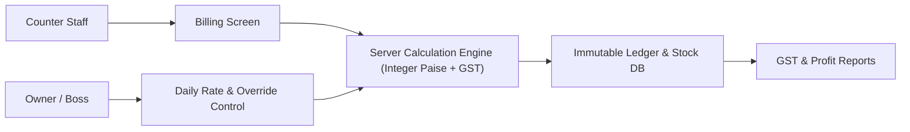

# Application Handbook Template (`docs/product/HANDBOOK-<slug>.md`)

```markdown
# Application Handbook: <Product Name>

- **Project Slug:** `<slug>`
- **Prepared By:** Boss Interface & Discovery Lead (`scf-handbook`)
- **Risk Tier:** `<Lean | Medium | Full>`
- **Status:** `READY_FOR_SCOPING`

---

## 1. Business Model & Golden Rules (Dukaan / Business Ka Niyam)
- **Core Purpose:** <Plain-language 2-sentence explanation>
- **Golden Invariants:**
  1. All money math uses exact integer paise (no floating-point decimals).
  2. All precious metal weights (if applicable) use exact integer milligrams.
  3. Audit trail: Financial/invoice records are append-only (void/credit-note instead of silent delete).

---

## 2. Step-by-Step User Journeys

### Journey 1: <Primary Happy-Path Workflow>
1. **Start:** <Who opens which screen>
2. **Input:** <Exact fields entered>
3. **Server Rule:** <What server validates and computes automatically>
4. **Output:** <Receipt / Invoice / Ledger update>
5. **Edge-Case Protection:** <What happens on slow internet / duplicate click / invalid input>

### Journey 2: <Exception / Return / Override Workflow>
1. ...

---

## 3. Role & Permission Matrix (`RBAC` — Kaun Kya Kar Sakta Hai)
*`RBAC` (Role-Based Access Control) matlab har staff member ko sirf uske kaam jitne buttons dikhna — Google search: `"role based access control matrix"`.*

| Module / Action | Owner / Boss | Manager / Munim | Counter Staff | CA / Auditor (Read-Only) |
| :--- | :--- | :--- | :--- | :--- |
| Set Daily Rates | Allow | View Only | View Only | View Only |
| Create Invoice | Allow | Allow | Allow | Deny |
| Cancel / Void Invoice | Allow | Approval Req | Deny | Deny |
| Extra Discount Override | Allow | Capped | Deny | Deny |
| Export GST / Ledger Reports | Allow | Allow | Deny | Allow |

---

## 4. Visual Connection Map


---

## 5. Next Automatic Step
- Hand off to Master Build Orchestrator (`/scf-scope`) to slice this Handbook into prioritized build phases.
```
