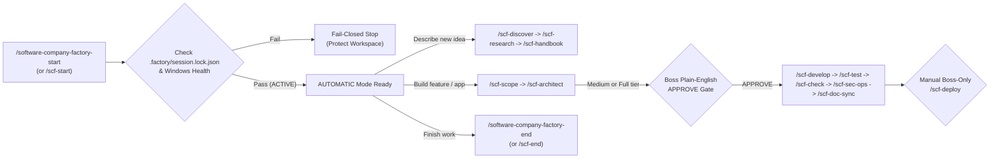
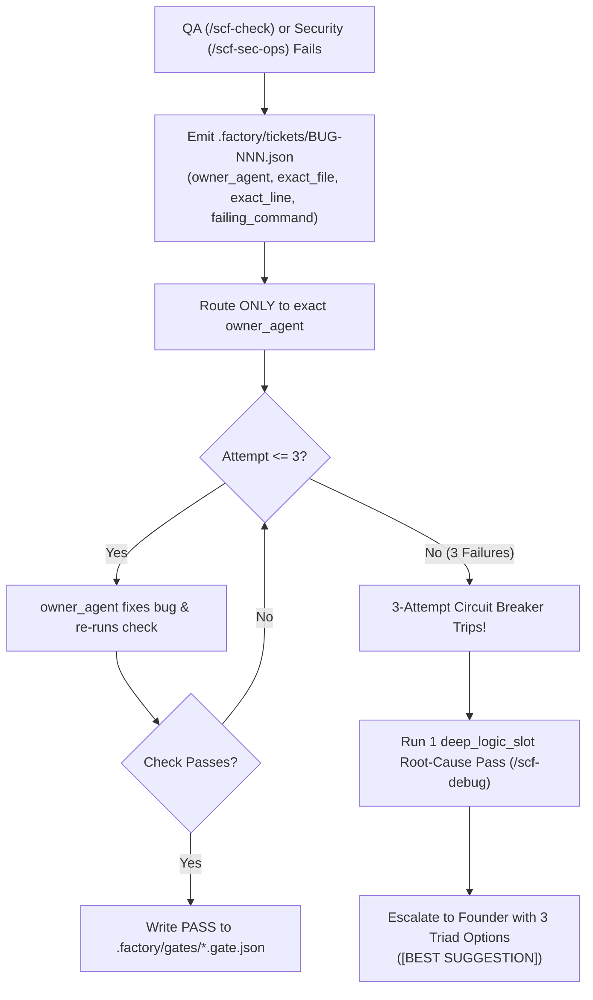
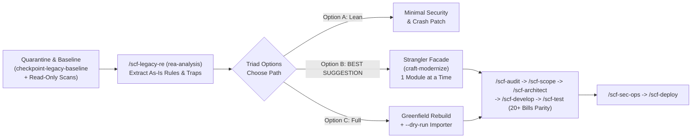
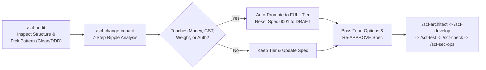

# Software Company Factory (`software-company-factory`) — Founder & Client Guide

**Version:** 1.1.0 | **Platform:** Windows 11 (PowerShell) + Google Antigravity 2.0 | **Audience:** Non-Coder Founders & Clients

Welcome to **Software Company Factory** — your reusable AI software engineering operating system ("Mother Factory"). Instead of a chaotic single AI chat that guesses requirements, overwrites files, or breaks billing math, this factory runs like a disciplined 12-person software company with strict safety gates, plain-English approvals, and machine-verified proof before anything is ever marked "done."

---

## 1. System Overview: Automatic Mode vs. Manual Slash Commands

### What Makes This Factory Different?
- **Plain-English First, Zero Mystery:** Every decision is explained in everyday English. Whenever a technical term is unavoidable, you get a 1-line meaning and a Google-searchable keyword.
- **Triad Options (`[BEST SUGGESTION]`):** Agents never ask vague open-ended technical questions. You always get **3 concrete choices** (Simple / Balanced / Enterprise) with clear pros, cons, and one marked **`[BEST SUGGESTION]`**.
- **100% Model-Agnostic:** No skill or script hardcodes an AI vendor model. All work routes dynamically through **5 abstract model slots** in `.factory/models.json` (`allow_founder_ui_model_selection: true`):
  - `light_ops_slot` — Status updates, discovery interviews, docs, and `Vibe` tweaks.
  - `worker_slot` — Everyday coding, UI/backend wave workers, and test suites.
  - `architect_slot` — System architecture, stack selection, and specs.
  - `deep_logic_slot` — Financial math, security/auth, and stubborn root-cause debugging.
  - `blind_reviewer_slot` — Independent `Full`-tier code review & spec critic (prefers an alternate model family, or a fresh zero-history session of `deep_logic_slot`).
- **Workstation-Safe (Windows 11, 16 GB RAM):** Cloud AI only (no heavy local LLMs), max **3 concurrent workers per wave**, max **4 always-on MCP servers** (`filesystem`, `github`, `sequential-thinking`, on-demand `playwright`/`postgres`), sequential on-demand security scans, and zero Linux/bash-only scripts.
- **Strict Department Isolation:** Every session checks `.factory/session.lock.json` so `software-company-factory` never mixes files or context with any other AI company department.

### Automatic Mode vs. Manual Slash Commands

Once you boot the factory, it runs in **`AUTOMATIC` mode** — you just describe what you want in plain English, and the Master Build Orchestrator routes your request through the right specialists automatically. You can also run any `/scf-*` slash command manually whenever you want direct control.



| Mode / Command | Alias | When to Use It | What Happens Automatically |
| :--- | :--- | :--- | :--- |
| **Start Session** | `/software-company-factory-start` or `/scf-start` | Start of every work session | Checks department lock, restores memory from `STATUS.md` & `docs/handoff/LATEST_SESSION.md`, runs Windows sanity check, activates `AUTOMATIC` mode. |
| **Automatic Mode** | *(Default after start)* | Normal day-to-day building | You talk in plain English; the factory automatically picks `/scf-discover`, `/scf-scope`, `/scf-architect`, `/scf-develop`, `/scf-check`, `/scf-sec-ops`, and `/scf-doc-sync`. |
| **Manual Overrides** | `/scf-discover`, `/scf-audit`, `/scf-change-impact`, `/scf-check`, `/scf-debug`, `/scf-sec-ops`, etc. | When you want to run one specific specialist step | Runs that exact skill directly while still obeying all 15 fail-closed safety hooks and file ownership rules. |
| **Production Release** | `/scf-deploy` | Ready to go live to real users | **100% Manual Boss-Only Gate.** Never runs automatically. Verifies all `.gate.json` proofs, security gates, and rollback tags, then asks your explicit confirmation. |
| **End Session** | `/software-company-factory-end` or `/scf-end` | End of work or switching departments | Verifies clean tree, runs atomic Git checkpoint, updates `STATUS.md` & `LATEST_SESSION.md`, and sets `.factory/session.lock.json` to `ENDED`. |

---

## 2. The 12 Permanent Specialist Agents & Dynamic Wave Pool

Instead of one AI trying to do everything at once, the factory divides work across **12 permanent specialist agents** plus a **Dynamic Wave Pool** for parallel building.

### The 12 Permanent Agents & Strict Single-File Ownership

Each folder has **one sole authorized writer** so two agents never overwrite each other's work:

| # | Agent Role | Primary Skills | Sole Authorized Writer (File Ownership) |
| :--- | :--- | :--- | :--- |
| **1** | **Boss Interface & Discovery Lead** | `scf-discover`, `scf-research`, `scf-handbook` | `docs/product/*` |
| **2** | **Master Build Orchestrator** | `scf-scope`, `scf-change-impact`, `start` / `end` | `docs/scope/*`, `.factory/waves/wave-plan.json` |
| **3** | **Chief Architect & Stack Selector** | `scf-architect`, `scf-audit` | `docs/specs/*` *(builders may update `Status:` line only)* |
| **4** | **Frontend Lead Orchestrator** | `scf-develop` (UI track) | `src/web/*`, `src/app/*`, `src/components/*` |
| **5** | **Backend Lead Orchestrator** | `scf-develop` (Logic track) | `src/server/*`, `src/api/*`, `src/services/*` |
| **6** | **Database & Schema Builder** | `scf-develop` (Data track) | `src/db/*`, `prisma/*`, `migrations/*` |
| **7** | **Dynamic Frontend Sub-Agent Pool** | `scf-develop` (Wave workers) | 1–2 assigned UI screens/components per worker |
| **8** | **Dynamic Backend Sub-Agent Pool** | `scf-develop` (Wave workers) | 1 assigned API endpoint/engine per worker |
| **9** | **GitHub, Version Control & Backup Agent** | `git-checkpoint.mjs`, `ast-collision-guard.mjs` | Git commits, rollback tags, collision checks |
| **10** | **QA Verification & Testing Agent** | `scf-check` (`verify`), `scf-test` | `tests/*`, `.factory/gates/*` |
| **11** | **Cross-Model Reviewer & Debugger** | `scf-check` (`review`), `scf-debug` | `.factory/tickets/BUG-*.json` (review/debug findings) |
| **12** | **Security, Compliance & Release Officer** | `scf-sec-ops`, `scf-doc-sync`, `scf-deploy`, `scf-legacy-re`, `scf-hardware-compliance` | Security reports in `.factory/gates/*`, `AGENTS.md`, `STATUS.md`, `docs/handoff/*` |

### Dynamic Flat Wave Protocol (Safe Parallel Building)
- **No Nested Chaos:** Leads never spawn sub-agents inside sub-agents. Instead, they write `.factory/waves/wave-plan.json` with strictly disjoint (non-overlapping) file paths.
- **Max 3 Workers Per Wave:** The Master Build Orchestrator dispatches at most **3 concurrent fresh workers** per wave to stay comfortably inside your 16 GB RAM limit.
- **Focused Context (`<= 40 KB`):** Each worker receives only a **<= 40 KB context slice** (and hot-path stays `<= 90 KB`), keeping reasoning sharp and preventing memory bloat.
- **Collision Guard + Atomic Backup:** After every wave finishes, `scripts/ast-collision-guard.mjs` verifies zero symbol/file collisions and `scripts/git-checkpoint.mjs` creates a clean Git checkpoint.

### The `BUG-*.json` Auto-Fix Loop & 3-Attempt Circuit Breaker



---

## 3. Complete Verified 18 Skills, 15 Fail-Closed Hooks & 4 Workflow Tiers

### All 18 Verified Skills (`.agents/skills/<name>/SKILL.md`)

| # | Skill Name | Assigned Agent | Plain-English Purpose |
| :--- | :--- | :--- | :--- |
| 1 | `software-company-factory-start` (`/scf-start`) | Agent #2 | Boots an isolated session, checks Windows health, restores memory, and turns on `AUTOMATIC` mode. |
| 2 | `software-company-factory-end` (`/scf-end`) | Agent #2 | Verifies clean files, runs Git checkpoint, updates `STATUS.md` & `LATEST_SESSION.md`, sets lock `ENDED`. |
| 3 | `scf-discover` | Agent #1 | Interviews you in plain English, applies Triad Options & "Grill Me" edge-case tests, writes discovery briefs. |
| 4 | `scf-research` | Agent #1 | Checks real-world facts (Indian GST, HSN, UPI, libraries) with confidence tags (`confirmed`, `likely`, `possible`, `uncertain`). |
| 5 | `scf-handbook` | Agent #1 | Creates a 5-minute plain-English "Owner's Manual" showing users, journeys, permissions, and workflow maps. |
| 6 | `scf-scope` | Agent #2 | Slices big ideas into buildable vertical features and assigns each the right Workflow Tier (`Vibe` to `Full`). |
| 7 | `scf-audit` | Agent #3 | Inspects existing codebases, picks the cleanest architecture pattern (Clean, DDD, Functional, SOLID OOP), flags debt. |
| 8 | `scf-change-impact` | Agent #2 | Runs a 7-step ripple-effect check before any mid-project change so a small tweak never breaks billing or data. |
| 9 | `scf-architect` | Agent #3 | Picks the best tech stack, writes dual Plain-English + Technical Specs (`Spec 0001` & `0002`), enforces Boss `APPROVE` gate. |
| 10 | `scf-develop` | Agents #4, #5, #6, #7, #8 | Orchestrates Database, Backend, and Frontend leads + max-3 wave workers (`<= 40 KB` slices) with collision checks. |
| 11 | `scf-test` | Agent #10 | Writes automated unit, integration, E2E, and financial boundary tests in `tests/`. |
| 12 | `scf-check` | Agents #10, #11 | Runs live runtime verification (`verify` mode) and fresh zero-history blind review (`review` mode), certifies `.gate.json`. |
| 13 | `scf-debug` | Agent #11 | Performs hypothesis-driven root-cause debugging (`deep_logic_slot`) and enforces the 3-attempt circuit breaker. |
| 14 | `scf-sec-ops` | Agent #12 | Runs 5-stage fail-closed security audits (Gitleaks, PII/Argon2id, prod hardening, deep logic, attacker review). |
| 15 | `scf-doc-sync` | Agent #12 | Keeps `STATUS.md`, `AGENTS.md`, `README.md`, and `LATEST_SESSION.md` synced with verified reality. |
| 16 | `scf-deploy` | Agent #12 | Enforces the **100% Manual Boss-Only** production release gate after verifying all proofs and rollback tags. |
| 17 | `scf-legacy-re` | Agent #12 | Dormant plug-in for reverse-engineering (`rea-analysis`) and safely modernizing (`craft-modernize`) legacy apps/Excel. |
| 18 | `scf-hardware-compliance` | Agent #12 | Dormant zero-overhead plug-in that activates only for physical hardware (weighing scales, barcode printers, IoT). |

### All 15 Fail-Closed Hooks (`.agents/hooks.json`)

"Fail-closed" means if any check fails (non-zero exit), the factory **stops immediately** — failures are never downgraded to warnings.

| # | Hook ID | Trigger Event | What It Blocks / Verifies |
| :--- | :--- | :--- | :--- |
| 1 | `session-lock-check` | `pre-mutation` | Blocks file edits if `.factory/session.lock.json` is not `ACTIVE` for `software-company-factory`. |
| 2 | `block-eval-usage` | `pre-commit` | Rejects `eval()`, `new Function()`, and unsafe dynamic code execution. |
| 3 | `block-float-money` | `pre-commit` | Rejects floating-point math on currency, GST, gold weight, or ledger fields (must use integer paise / milligrams / `Decimal` / `BigInt`). |
| 4 | `block-env-staging` | `pre-commit` | Hard-blocks staging `.env`, `.env.local`, private keys, or credentials into Git. |
| 5 | `block-hardcoded-secrets` | `pre-commit` | Runs Gitleaks/regex secret scan on staged diffs and client bundle prefixes. |
| 6 | `block-assumed-spec-done` | `pre-gate` | **Spec 0001:** Blocks marking any feature `DONE` if its spec is still `ASSUMED` or `DRAFT`. |
| 7 | `block-unsourced-values` | `pre-gate` | **Spec 0002:** Rejects specs missing Value Sourcing entries (exact DB/API source) for UI/API fields. |
| 8 | `pre-commit-portability` | `pre-commit` | Validates skill byte budgets (`4 KB–32 KB`), `openai.yaml`, and zero hardcoded model names (`check-portability.mjs`). |
| 9 | `pre-commit-ast-collision` | `pre-wave-merge` | Checks file-lock manifests and symbol diffs across parallel wave workers (`ast-collision-guard.mjs`). |
| 10 | `pre-commit-lint-typecheck` | `pre-commit` | Runs project linter and strict TypeScript/syntax typecheck. |
| 11 | `pre-commit-unit-tests` | `pre-commit` | Runs affected unit tests before atomic commit. |
| 12 | `post-wave-git-checkpoint` | `post-wave` | Verifies wave checkpoint readiness and runs atomic commit + rollback tag (`git-checkpoint.mjs`). |
| 13 | `pre-release-security-gate` | `pre-release` | Runs 5-stage `scf-sec-ops` checks (semgrep, trivy, gitleaks, PII check, logic audit). |
| 14 | `pre-deploy-gate-verify` | `pre-deploy` | Verifies all `.factory/gates/*.gate.json` records are `PASS` before release (`gate-check.mjs --all`). |
| 15 | `block-unapproved-deploy` | `pre-deploy` | Hard-blocks automated production deploy without explicit manual Boss `/scf-deploy` approval. |

### The 4 Workflow Tiers (Right-Sized Safety)

| Tier | Typical Tasks | Checks | Boss Spec Approval? | Security Stages | Mandatory Pipeline | Model Slots Used |
| :--- | :--- | :---: | :---: | :---: | :--- | :--- |
| **Vibe** | Copy edit, color tweak, tiny polish | **3** | No | Hooks only | Lint + Typecheck + Self-check + `git commit` | `light_ops_slot` |
| **Lean** | Simple CRUD form, static page, utility | **6** | No | Stage 1 | Vibe + `/scf-check verify` + `.gate.json` | `worker_slot` |
| **Medium** | ERP module (Inventory, CRM, Reports) | **11** | **Yes (`APPROVE`)** | Stages 1–3 | Lean + Boss Spec Approval + `/scf-test` + `scf-sec-ops` (1–3) + AST Guard | `architect_slot` + `worker_slot` |
| **Full** | Money, GST, gold weight, auth, payments | **15+** | **Yes (`APPROVE`)** | **All 5 Stages (1–5)** | Medium + Blind `/scf-check review` + 5-Stage `scf-sec-ops` + `block-float-money` + `/scf-doc-sync` + Boss UAT | `architect_slot` + `deep_logic_slot` + `blind_reviewer_slot` |

---

## 4. Three Complete Client Roadmaps (With Examples)

### Journey A: Zero-to-One Idea (Example: Custom Jewelry ERP)
*Best when you are starting from scratch with a business idea (like GST billing, 22K/18K gold weight tracking, karigar ledger, and customer udhaar).*

```mermaid
flowchart LR
    A1["/scf-start"] --> A2["/scf-discover\n(Triad + Grill Me)"]
    A2 --> A3["/scf-research\n(GST/HSN + Confidence Tags)"]
    A3 --> A4["/scf-handbook\n(5-Min Owner Manual)"]
    A4 --> A5["/scf-scope\n(Slice into Vibe..Full)"]
    A5 --> A6["/scf-architect\n(Spec 0001 & 0002)"]
    A6 -->|"Boss replies APPROVE"| A7["/scf-develop\n(Max-3 Wave Workers)"]
    A7 --> A8["/scf-test & /scf-check\n(Verify + Blind Review)"]
    A8 --> A9["/scf-sec-ops\n(5-Stage Security)"]
    A9 --> A10["/scf-doc-sync"]
    A10 -->|"Manual Boss Gate"| A11["/scf-deploy"]
```



1. **Discover & Stress-Test (`/scf-discover`):** You explain your Jewelry Shop idea. Agent #1 asks "Grill Me" edge-case questions (*"What if a customer pays half cash, half UPI, and exchanges old gold?"*) and writes `docs/product/DISCOVERY-jewelry-erp.md`.
2. **Verify Real-World Rules (`/scf-research` & `/scf-handbook`):** Checks Indian GST slabs, HSN codes, and hallmark rules with confidence tags, then gives you a 5-minute Owner's Manual.
3. **Scope & Approve (`/scf-scope` & `/scf-architect`):** Slices the ERP into features. Billing & Gold Weight are tagged **`Full` tier**. You read Part A (Plain-English Summary) and reply **`APPROVE`**.
4. **Build, Test & Secure (`/scf-develop` -> `/scf-test` -> `/scf-check` -> `/scf-sec-ops`):** Max-3 parallel wave workers build integer-paise & integer-milligram math. A fresh blind reviewer checks the code, all 5 security stages pass, and you manually trigger `/scf-deploy` when ready.

---

### Journey B: Reverse-Engineer & Rebuild a Legacy App / Excel (`scf-legacy-re`)
*Best when a client already has an old PHP/VB/Node app or messy Excel sheets with undocumented formulas and hidden bugs.*



1. **Quarantine First:** The factory takes a clean baseline snapshot (`checkpoint-legacy-baseline`) and runs read-only safety scans (`block-eval-usage`, `block-float-money`, `block-hardcoded-secrets`) without breaking the live app.
2. **Uncover True Rules (`rea-analysis`):** Inspects actual code and spreadsheets to find hidden traps (e.g., old code using `Float` causing ₹1–2 rounding drift) and marks unclear rules `[uncertain]` for you to confirm.
3. **Pick a Safe Triad Path:** Usually **`[BEST SUGGESTION]` Strangler Facade Migration (`craft-modernize`)** — replacing one painful module at a time while keeping daily shop operations running.
4. **Prove Parity Before Cutover:** `/scf-test` runs **Shadow Reconciliation** on at least **20 historical transactions** to prove the new integer-paise/milligram outputs match verified historical bills before `/scf-deploy`.

---

### Journey C: Upgrade or Modernize an Existing Project Safely (`scf-audit -> scf-change-impact -> scf-architect`)
*Best when an app is already built and you need a mid-project rule change (e.g., new GST rule, split payment, or adding a new module) without breaking old invoices.*



1. **Structure Audit (`/scf-audit`):** Inspects the codebase, selects the cleanest architecture pattern (such as **Clean Architecture** for ERPs or **DDD** for large multi-module apps), and flags tech debt before any edits.
2. **7-Step Ripple-Effect Check (`/scf-change-impact`):** Maps every impact across: (1) Before/After plain-English change, (2) DB & historical records (*ensuring old invoices keep their historical tax/rate*), (3) Backend API & Spec 0002 Value Sourcing, (4) Frontend UI, (5) Risk Tier escalation (any money/auth touch auto-promotes to **`Full` tier**), (6) Stale tests/gates to re-run, and (7) Rollback tag + 3 Triad Options.
3. **Re-Approve & Build (`/scf-architect` -> `/scf-develop` -> `/scf-check`):** Spec 0001 resets to `DRAFT` until you reply `APPROVE`, then wave workers implement the update and re-verify all affected gates.

---

## 5. Real Verification Proof Appendix

All checks below were executed live on the `software-company-factory` repository by `@verifier` (read-only verification, **all 7 commands exited with code `0`**).

### 5.1 GitHub Repository & Git Integrity (Exit Codes: `0`, `0`, `0`)

**`gh repo view --json name,visibility,url,defaultBranchRef`** *(exit code `0`)*:
```json
{"defaultBranchRef":{"name":"main"},"name":"software-company-factory","url":"https://github.com/aipro831gith/software-company-factory","visibility":"PRIVATE"}
```

**`git ls-remote --heads --tags origin`** *(exit code `0`)*:
```text
10b88eeb21de849a573c20d09cc82de0db36363b	refs/heads/main
60b39009931e86eccba1dbd0191acc328a1f2e3d	refs/tags/checkpoint-init
d3067f790a760e2313e26b6c18218c375af13b23	refs/tags/checkpoint-wave-2
e857e289a8e539d3e7ad2db32962b20775165c9a	refs/tags/checkpoint-wave-3
10b88eeb21de849a573c20d09cc82de0db36363b	refs/tags/checkpoint-wave-4
```

**`git status`** *(exit code `0`)*:
```text
On branch main
Your branch is up to date with 'origin/main'.

nothing to commit, working tree clean
```

---

### 5.2 Factory Verification Scripts (Exit Codes: `0`, `0`, `0`, `0`)

**`node scripts/check-portability.mjs`** *(exit code `0`, **18/18 skills passed** — all with `SKILL.md`, `agents/openai.yaml`, and 0 hardcoded model names)*:
```text
=== check-portability.mjs :: PASS ===
Validated skills: 18/18
  [OK] scf-architect (SKILL.md=12322B, hotPath=19510B, subFiles=4)
  [OK] scf-audit (SKILL.md=4913B, hotPath=8389B, subFiles=4)
  [OK] scf-change-impact (SKILL.md=4619B, hotPath=6241B, subFiles=1)
  [OK] scf-check (SKILL.md=5467B, hotPath=8265B, subFiles=3)
  [OK] scf-debug (SKILL.md=4458B, hotPath=5752B, subFiles=1)
  [OK] scf-deploy (SKILL.md=4593B, hotPath=5779B, subFiles=1)
  [OK] scf-develop (SKILL.md=6340B, hotPath=11819B, subFiles=5)
  [OK] scf-discover (SKILL.md=6594B, hotPath=10661B, subFiles=2)
  [OK] scf-doc-sync (SKILL.md=5327B, hotPath=6812B, subFiles=2)
  [OK] scf-handbook (SKILL.md=4743B, hotPath=7071B, subFiles=1)
  [OK] scf-hardware-compliance (SKILL.md=4972B, hotPath=5931B, subFiles=1)
  [OK] scf-legacy-re (SKILL.md=5263B, hotPath=7038B, subFiles=2)
  [OK] scf-research (SKILL.md=4687B, hotPath=8340B, subFiles=3)
  [OK] scf-scope (SKILL.md=6495B, hotPath=9873B, subFiles=4)
  [OK] scf-sec-ops (SKILL.md=7236B, hotPath=12783B, subFiles=5)
  [OK] scf-test (SKILL.md=4514B, hotPath=6568B, subFiles=2)
  [OK] software-company-factory-end (SKILL.md=4202B, hotPath=5226B, subFiles=1)
  [OK] software-company-factory-start (SKILL.md=6533B, hotPath=7578B, subFiles=1)
```

**`node scripts/hook-runner.mjs --self-test`** *(exit code `0`, **14/14 checks passed**)*:
```text
[PASS] Self-test "session-lock ACTIVE": Session lock ACTIVE for software-company-factory.
[PASS] Self-test "session-lock ENDED blocks": Session lock status is "ENDED". Run /software-company-factory-start first.
[PASS] Self-test "block-float-money traps float GST": Floating-point money/weight math detected at src\badGst.js:1. Use integer paise/milligrams, BigInt, or Decimal.
[PASS] Self-test "block-float-money allows BigInt paise": Scanned 1 file(s): zero floating-point money/weight violations.
[PASS] Self-test "block-eval-usage traps eval()": Unsafe dynamic code execution (eval/Function) found in src\badEval.js
[PASS] Self-test "block-env-staging traps .env": Blocked sensitive files from staging/commit: .env.local
[PASS] Self-test "block-env-staging allows .env.example": Zero .env or private key files staged.
[PASS] Self-test "block-hardcoded-secrets traps API key": Potential secret (Google API key) detected in src\secret.js
[PASS] Self-test "block-assumed-spec-done traps ASSUMED+DONE": Spec 0001 violation: SPEC-001.md has BuildState DONE while Status is ASSUMED.
[PASS] Self-test "block-unsourced-values traps missing Value Sourcing": Spec 0002 violation: SPEC-001.md is Medium/Full tier but missing Value Sourcing section.
[PASS] Self-test "block-unapproved-deploy blocks without Boss approval": Production deploy blocked: explicit manual Boss /scf-deploy approval is required.
[PASS] Self-test "pre-commit-portability on Mother Factory": check-portability.mjs passed.
[PASS] Self-test "pre-commit-lint-typecheck on Mother Factory": Node syntax check passed for factory scripts.
[PASS] Self-test "pre-commit-ast-collision on Mother Factory": ast-collision-guard.mjs passed.

Self-test summary: 14/14 checks passed.
```

**`node scripts/ast-collision-guard.mjs --self-test`** *(exit code `0`)*:
```text
[PASS] ast-collision-guard.mjs self-test verified file collision detection.
```

**`node scripts/analyze-token-usage.mjs`** *(exit code `0`)*:
```text
=== software-company-factory :: Context & Slot Usage Report ===
Routing Mode: FOUNDER_OVERRIDE_ALLOWED (UI Override: true)
Configured Abstract Slots (5): light_ops_slot, worker_slot, architect_slot, deep_logic_slot, blind_reviewer_slot

Wave Plan: No active wave-plan.json yet.

Bug Tickets (0):
```

---

### 5.3 Verified Configuration Summary (`.factory/models.json` & `.agents/hooks.json`)

- **`.factory/models.json`** (`schema_version: "1.0"`, `routing_mode: "FOUNDER_OVERRIDE_ALLOWED"`, `allow_founder_ui_model_selection: true`):
  - `light_ops_slot`: primary `gemini-4-hydrogen` (`medium`), fallback `active-antigravity-default` (`high`)
  - `worker_slot`: primary `gemini-4-hydrogen` (`high`), fallback `active-antigravity-default` (`high`)
  - `architect_slot`: primary `gemini-4-hydrogen` (`xhigh`), secondary `claude-sonnet-4.6` (`high`), fallback `active-antigravity-default` (`high`)
  - `deep_logic_slot`: primary `gemini-4-hydrogen` (`xhigh`), fallback `active-antigravity-default` (`xhigh`)
  - `blind_reviewer_slot`: `prefer_different_family: true`, primary `claude-sonnet-4.6` (`high`), fallback `gemini-4-hydrogen` (`xhigh`, `require_fresh_session: true`)
- **`.agents/hooks.json`** (`schema_version: "1.0"`, `fail_closed: true`): All **15/15 hooks** verified with `fail_closed: true`.
- **`.agents/skills/`**: All **18/18 skills** verified with `SKILL.md` + `agents/openai.yaml` and **0 hardcoded model names**.
