# `software-company-factory` v2.0 — Founder & Client Guide

**Welcome!** This plain-language handbook explains how your **v2.0 Enterprise Specialist-Grade Software Factory** (`C:\dev\software-company-factory`) works — with **zero coding jargon** and **real verified system proof**.

---

## 1. System Overview & Latest Antigravity v2.0 Architecture

Think of `software-company-factory` as an **AI Software Engineering Company in a Box**:
- **Default Automatic Mode:** Type `/software-company-factory-start`, explain your idea in plain Hinglish or simple English, reply **`APPROVE`** on the Plain-English Spec when asked, watch live progress on the **₹0 Boss Dashboard (`http://localhost:4173`)**, and finish with `/software-company-factory-end`.
- **Manual Slash Overrides:** Every skill in `.agents/skills/` can also be triggered directly (`/scf-discover`, `/scf-grill-me`, `/scf-architect`, `/scf-swarm-dispatch`, `/scf-sec-ops`, `/scf-deploy`).
- **Zero-Caveman Boss Rule:** Internal agent-to-agent handoffs and Swarm board logs use compact `caveman` shorthand to save ~65–75% tokens, but **all Boss-facing chats, specs, and dashboards stay 100% polite, clear everyday language**.
- **100% Model-Agnostic:** AI models resolve dynamically from `.factory/models.json` (`light_ops_slot`, `worker_slot`, `architect_slot`, `deep_logic_slot`, `blind_reviewer_slot`). Swap any future model anytime without editing skills.

```mermaid
flowchart LR
  Boss["Founder / Boss (Plain Hinglish/English)"] -->|"/software-company-factory-start"| Coordinator["Agent #3 Coordinator"]
  Coordinator --> Discovery["Agents #1-#2: Discover + Grill Me + Research"]
  Discovery --> Architect["Agent #4: Plain-English Spec Gate (APPROVE)"]
  Architect --> Swarm["Hybrid /swarm + workflow-runner.mjs (3-5 Workers)"]
  Swarm --> QA["Agents #9-#11: QA + 5-Stage Security + Blind Review"]
  QA -->|"PASS"| Deploy["Agent #13: Manual Boss /scf-deploy + localhost:4173"]
```

---

## 2. Exact Agent Count: 15 Dedicated Specialist Agents + Dynamic Swarm Pool

| # | Dedicated Specialist Agent | Department | Plain-Language Job |
| :--- | :--- | :--- | :--- |
| **1** | Salesman & Client Discovery Lead | Front Desk | Interviews you in plain language + runs `/scf-grill-me` edge-case stress tests |
| **2** | Market & Tech Researcher | Front Desk | Checks real tax/GST/market facts with `[confirmed]` vs `[uncertain]` tags |
| **3** | Master Coordinator & Swarm Lead | Command | Slices work, enforces domain routing, dispatches `/swarm` & `workflow-runner.mjs` |
| **4** | Chief System Architect | Command | Picks best stack + writes Dual Spec (`Spec 0001` & `Spec 0002`) for Boss approval |
| **5** | Change-Impact & Codebase Auditor | Command | Runs 7-step ripple-effect check before any mid-project change |
| **6** | Frontend Lead (+ Swarm Workers) | Builders | Builds UI screens, design systems, and counter layouts (`src/web/`, `src/app/`) |
| **7** | Backend Lead (+ Swarm Workers) | Builders | Builds APIs, auth, and exact integer-paise/GST math (`src/server/`, `src/services/`) |
| **8** | Database & Schema Specialist | Builders | Owns tables, migrations, foreign keys, and integer paise/mg columns (`src/db/`) |
| **9** | **Dedicated Cybersecurity Specialist** | Security | Separate full-time security officer running 5-stage audits + `block-client-agpl-leak` |
| **10** | QA Verification & Browser Tester | Quality | Runs Playwright E2E, unit/integration tests, and live API checks (`tests/`) |
| **11** | Cross-Model Blind Reviewer & Debugger | Quality | Fresh-session blind review on `Full` tier + 3-attempt root-cause debugger |
| **12** | GitHub, Version Control & Backup | Integrity | Runs AST collision checks, atomic Git commits, wave tags, and GitHub push |
| **13** | Docs, Dashboard & Release Gatekeeper | Release | Updates `STATUS.md`, serves ₹0 Boss Dashboard, guards manual `/scf-deploy` |
| **14** | **Legacy Reverse-Engineering Specialist** | Modernize | Separate specialist for understanding and modernizing old apps (`scf-legacy-re`) |
| **15** | **Hardware & IoT Compliance Specialist** | Hardware | Separate dormant specialist for weighing scales, barcode printers & IoT |

### Hybrid `/swarm`, ≤ 40 KB Slices & Auto-Fix Circuit Breaker
- **Concurrency Cap:** Default **3 workers**, burst max **5 workers** on 16 GB RAM; each worker receives strictly disjoint file paths and **≤ 40 KB** context slice.
- **Hard Domain Routing:** Even a 2-line UI, API, or DB change routes through its owning agent and logs to `.factory/board/messages.jsonl`.
- **3-Attempt Circuit Breaker:** Failures emit `.factory/tickets/BUG-<NNN>.json` routed strictly to `owner_agent`; after 3 failed attempts, `/scf-debug` (`deep_logic_slot`) escalates with 3 Triad Options.

---

## 3. Verified 20 Skills, 31 Specialist Repos, 16 Hooks & 4 Tiers

- **20 Canonical Factory Skills (`.agents/skills/`):** `software-company-factory-start`, `software-company-factory-end`, `scf-discover`, `scf-grill-me`, `scf-research`, `scf-handbook`, `scf-change-impact`, `scf-scope`, `scf-swarm-dispatch`, `scf-audit`, `scf-architect`, `scf-develop`, `scf-check`, `scf-test`, `scf-debug`, `scf-sec-ops`, `scf-doc-sync`, `scf-deploy`, `scf-legacy-re`, `scf-hardware-compliance`.
- **31 Pre-Bundled Specialist Repos (`.factory/skills-registry.json`):** 18 Bucket A Core (`vendor/specialist-skills/core/` + `context7`/`github` MCPs) + 13 Bucket B Optional Dormant Plug-ins (`vendor/specialist-skills/optional/` + `magicuidesign` MCP), attributed in `THIRD_PARTY_LICENSES.md`.
- **16 Fail-Closed Guardrail Hooks (`.agents/hooks.json`):** Includes `session-lock-check`, `block-eval-usage`, `block-float-money`, `block-env-staging`, `block-hardcoded-secrets`, `block-assumed-spec-done`, `block-unsourced-values`, `pre-commit-portability`, `pre-commit-ast-collision`, `pre-commit-lint-typecheck`, `pre-commit-unit-tests`, `post-wave-git-checkpoint`, `pre-release-security-gate`, `pre-deploy-gate-verify`, `block-unapproved-deploy`, and **`block-client-agpl-leak`**.
- **4 Workflow Tiers:** `Vibe` (3 checks) → `Lean` (6 checks) → `Medium` (11 checks + Boss Spec Gate) → `Full` (15+ checks + Blind Review + 5-Stage Security + Integer Money Guard).

---

## 4. Three Complete Client Roadmaps

### Journey A: Zero-to-One New App (e.g., Jewelry Business ERP)
1. `/scf-discover` + `/scf-grill-me` (lock split cash+UPI+old-gold rules) → `/scf-research` → `/scf-handbook`
2. `/scf-scope` (`Full` tier slices) → `/scf-architect` (Boss replies `"APPROVE"` on Plain-English Spec)
3. `/scf-swarm-dispatch` + `/scf-develop` (3–5 workers build DB + Backend + UI) → `/scf-test` + `/scf-check` (`verify` + `review`) → `/scf-sec-ops` (Stages 1–5) → `/scf-deploy` (manual Boss release)

### Journey B: Reverse Engineer & Rebuild (`scf-legacy-re`)
1. Quarantine legacy code with clean Git baseline + read-only hazard scan (`block-float-money`, `block-eval-usage`, `block-hardcoded-secrets`)
2. Agent #14 runs `morluto/rea` + `storytold/craft-anything` (`modes/rea-analysis.md`) to map hidden formulas
3. Founder picks Triad Option → Strangler Facade rebuild + 20-case parity reconciliation tests (`modes/craft-modernize.md`)

### Journey C: Safely Upgrade a Live Running App
1. `/scf-audit` checks codebase health → `/scf-change-impact` maps 7-step ripple across DB, old invoices, API, UI, and tests
2. `/scf-architect` updates Spec (`Status: APPROVED`) → owning domain agents build via `/swarm` → `/scf-test` + `/scf-check` + `/scf-sec-ops` → manual `/scf-deploy`

---

## 5. ₹0 Local Boss Mission Control Dashboard (`http://localhost:4173`)

Run `node dashboard/server.mjs` and open **http://localhost:4173**:
- **₹0 Cost & `< 50 MB` RAM:** Pure Node.js `http` + `fs.watch` + live SSE stream (`0` LLM API calls).
- **Works on Windows & macOS:** Interactive tabs, 15-agent inspection drawer, live SSE board feed, real-time Check buttons (`Run 20/20 Check`, `Run 16 Hook Tests`, `Workflow Status`), Light/Dark theme toggle, and zero fake data.

---

## 6. Verified v2.0 Proof Appendix

- **GitHub Private Repo:** `https://github.com/aipro831gith/software-company-factory`
- **Local Workspace:** `C:\dev\software-company-factory`
- **Verified Checks:** `check-portability.mjs --require-all` (`20/20` skills `PASS`), `hook-runner.mjs --self-test` (`16/16` checks `PASS`), `workflow-runner.mjs --self-test` (`PASS`), `sync-vendor-skills.ps1` (`18` Core + `13` Optional verified), Boss Dashboard `http://localhost:4173` live verified.
